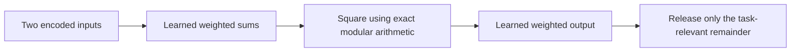

# A finite residue network: design, learning and checked information flow

Later local continuation: [bilinear network with algebraic learning](../bilinear-network/report.md)
replaces exponential fitting on a structured quadratic family and tests unseen
inputs. The results below preserve the original experiment and its limitations.

2026-10-25. **First bounded architecture deliverable complete.** This is a small
trainable polynomial network, source code, a Lean proof and exhaustive finite
checks. It is not an established novel architecture, a language model, scalable
learning or a proof against arbitrary collusion. All work in this loop ran locally;
no new hosted-model requests or cloud jobs were made.

## What was built, in plain English

Every computational word is an integer from 0 to 8. Its remainder after division
by 3 is its task-relevant part. Adding 3 or 6 changes an extra part of the word.
The threat model lets an adversary change those extra parts, including in network
weights and training examples. It does not let the adversary freely change the
task-relevant parts and then call those changes protected.

The network uses exact weighted sums and squaring modulo 9. Those operations
mathematically keep changes in the extra parts from changing the task-relevant
parts. The output is one canonical remainder. Ordinary floating-point arithmetic
is not used in this model.

The initial model has two hidden neurons and nine learned weights/biases. A smaller
one-hidden-neuron model with five learned weights also suffices on this task set.
The hidden weights are trained; this is not the earlier fixed-feature readout.



## Task and learning results

We fit every Boolean rule of two inputs: sixteen possible four-row truth tables,
including AND, OR, XOR and implication. All four inputs are training and
verification inputs. **There is no held-out generalization claim.**

The first learning rule uses formal polynomial gradients in the finite ring.
Across the two fixed learning rates and four fixed initializations it fits only
10/16 tasks for the two-unit network, and 6/16 for the one-unit network. Cycles
and step-limit failures are preserved. This is not successful standard backprop.

The repair is finite consistent-weight search. It fits all sixteen tasks by
enumerating possible semantic weights. This trains the hidden weights and readout,
but takes exponential search space. It establishes feasibility on the complete
small domain, not a practical large-model training algorithm.

| Architecture | Learned parameters | Semantic weight candidates | Tasks fitted by the fixed gradient attempts | Tasks fitted by exact weight search |
| --- | --- | --- | --- | --- |
| Modular affine baseline | 3 | 27 | Not evaluated | 6/16 |
| One square hidden neuron | 5 | 243 | 6/16 | 16/16 |
| Two square hidden neurons | 9 | 19,683 | 10/16 | 16/16 |

The affine baseline is a modular affine map, not a real-valued threshold classifier.
A direct four-entry truth-table solver also solves every task and is cheaper.
No superior task performance or compute saving is claimed. The one-unit result
is an important simplification: this tiny task does not require the larger model.

## What was proved and verified

Lean 4.35.0 accepts:

1. Projection commutes with every admitted addition/multiplication expression,
   at arbitrary expression depth, including all network weights as inputs.
2. Equal task-relevant remainders give equal observed outputs.
3. Any fixed sequence of polynomial state/update operations preserves that
   relation. This includes algebraically expressed update rules, not arbitrary
   floating-point optimizers.
4. A deterministic learner that receives only observed training data returns the
   same model when the extra parts change. That interface assumption is explicit.
5. Concrete certificates for all sixteen learned truth tables for each saved run.
   Correctness transfers to every encoded world with the same input/weight
   remainders. These are actual learned weights, not a different stand-in model.

The proof covers abstract exact arithmetic. The Python finite-search learner
normalizes admitted training observations before making choices and caching fits.
Its code and exhaustive training-input checks support that interface, but no
Python-to-Lean compiler/refinement or hardware timing proof is claimed.

The forward tests enumerate every independent extra-part choice in all learned
weights and all admitted inputs for the chosen task/model:

| Model | Weight variations per task | Encoded inputs per task | Cases over all 16 tasks | Wrong answers |
| --- | --- | --- | --- | --- |
| Two units | 3^9 = 19,683 | 4×3^2 = 36 | 11,337,408 | 0 |
| One unit | 3^5 = 243 | 36 | 139,968 | 0 |

These counts describe exhaustive finite families, not millions of independent
behavioral trials or evidence about arbitrary outputs. Round 1 and round 2 repeat
the two-unit forward family; their counts must not be added as independent evidence.

Per model, training tests also cover all 1,296 task/label-lift cases, all 104,976
task/input-lift cases and 4,096 seeded joint cases. Input and label families are
exhaustive separately; their Cartesian product was not exhaustively enumerated.
The final learner's fit API is actually exercised, including its canonical data
key, rather than merely asserting a hypothetical normalization property.

Forward tensor arithmetic uses int64 and bounded words. Hidden affine sums are
at most 136, squares at most 64 after reduction, and output sums at most 136.
Formal-gradient code uses Python integers (intermediate products up to 1,024 in
this model), so no machine-integer overflow is imported into the abstract claim.

## Attempts to break it and design revisions

- The preceding real-valued quotient prototype fails exact noninterference under
  ordinary float64 cancellation. It remains a rejected exact-backend candidate.
- A fixed-feature network was rejected before execution because only the readout
  would learn; the implemented network learns hidden weights too.
- Modular gradient attempts fail on several tasks. Weight search repairs finite
  fitting, with an explicit exponential-scaling limitation.
- Round 1 checked normalized training views. Round 2 strengthens that test to
  call the actual finite learner on every declared training-data variation.
- Round 3 prunes the model to one hidden unit after the ablation showed that it
  can represent every task. The smaller model passes its complete forward family.
- Releasing raw output rather than its observation transmits a scripted trit
  through the output bias: raw values 0,3,6 all have the same authorized answer 0.
  This positive control confirms that changing the observer invalidates the claim.
- A forbidden high-digit-extracting operation distinguishes words 0 and 3 despite
  their equal permitted remainder. Arbitrary nonlinear operations are not safe
  merely because the surrounding network uses modular arithmetic.

## What is still open

This is not a proof that a malicious model cannot encode messages in its permitted
semantic values, authorized query selection, timing, failures, raw hidden states
or physical resources. It also does not guarantee that the permitted semantic
inputs themselves contain no payload. A trusted encoding/release policy remains
necessary. The task answer is unique: perfect correctness plus canonical release
already closes this tiny content interface. The architecture shows a structural
way to maintain that restricted contract through computation, not a new universal
impossibility or security theorem.

The training-set size is four, finite search is exponential, and a lookup table
is a strong trivial solver. A useful new language architecture and practical
gradient learning are unresolved. The next design should address one of those
limitations before adding more toy cases. No next paid run is selected here.

## Prior art and novelty status

The [targeted prior-art assessment](prior-art.md) compares polynomial networks,
modular neural arithmetic, finite-ring fitting, congruence preservation,
canonical communication and architectural ML information-flow control. It records
reading scope and unavailable code/full-text checks. **No new neural primitive
or security theorem has been established.**

Our projection theorem says that the released answer is identical to running the
same polynomial network directly modulo 3 on reduced inputs and weights. The
extra parts add no expressive power for that answer. This is a standard
ring-homomorphism property, also represented by `ZMod.castHom` in mathlib.
Our contribution so far is the concrete checked demonstration and failure
analysis; independent research novelty remains unestablished.

ModuloNET already constructs modular neural networks for hardware masking. The
author's [2021 abstract](https://research.ece.ncsu.edu/aaysu/publication/modulonet-neural-networks-meet-modular-arithmetic-for-efficient-hardware-masking/)
was inspected 2026-10-25; its full proof and code were not audited in this loop.
Its threat model concerns hardware model-extraction attacks, not the exact
remainder-observer experiment here. That distinction does not by itself establish
novelty. Mihara's [p-adic Character Neural Network, arXiv 2603.29905v1](https://arxiv.org/abs/2603.29905v1),
submitted 2026-03-31, also relates neural models to polynomial equations over
finite rings; abstract and version metadata inspected only. A full closest-code
and theorem comparison remains incomplete. Polynomial networks and quotient-ring
arithmetic are established ideas. **Do not advertise this as the first modular,
p-adic or steganography-free neural architecture.**

## Reproduction and artifacts

- Source: `experiments/residue_network/run_loop.py`, `Residue.lean` and
  `verify_results.py`.
- Plans: `plan.md`, rejected `fixed-feature-draft.md`, and hash-matching plan
  snapshots in each result directory.
- Round 1: `results/residue-network-01/`, including the original source snapshot.
- Final two-unit result: `results/residue-network-02/`.
- Pruned result: `results/residue-network-03/`.
- Four successful Lean compilation/check commands and artifact checks:
  `results/residue-verification-01/verification.json`.

```bash
python -m experiments.residue_network.run_loop \
  --hidden-units 1 --output results/residue-network-repeat
python -m experiments.residue_network.verify_results \
  --output results/residue-verification-repeat
```

The verifier refuses to overwrite its existing output directory. It is designed
to verify the saved run artifacts; choose a fresh verification path for another
execution. Checkpoints are exact learned integer vectors recorded in metrics,
with source/configuration hashes and all gradient traces. No API keys, cloud
tokens or external source code are bundled.
